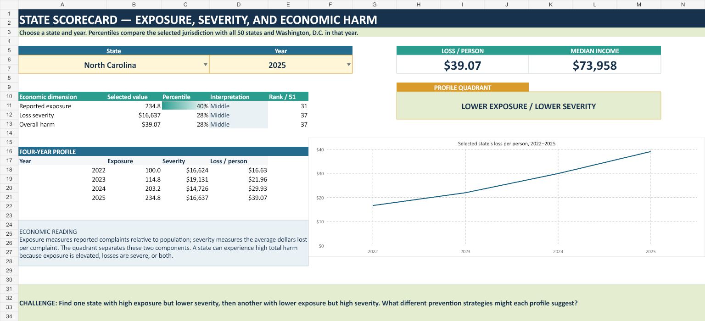
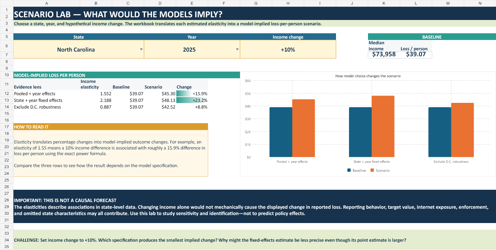

# Scam Geography

**The economics of reported online fraud across U.S. states**

An individual research project by **Om Patel** · 2022–2025 · 51 jurisdictions · 204 state-year observations

Where does reported online fraud impose the greatest economic harm—and how are those differences associated with income, internet access, and demographics?

Explore the question in Excel: compare states, separate reported exposure from loss severity, and examine how the evidence changes across statistical models.

**[Open the workbook download page](Scam_Geography_Interactive_Economics_Project.xlsx)** · [Explore the data](data/state_panel_2022_2025.csv) · [Variable definitions](DATA_DICTIONARY.md)

On the workbook page, choose **Download raw file**, then open the downloaded file in desktop Microsoft Excel. The images below are previews; the interactive controls are inside the workbook.

## Take a five-minute tour

| Step | Worksheet | Try it |
| --- | --- | --- |
| 1 | Start Here | Read the research question and the guide to the evidence. |
| 2 | Interactive Econ Lab | Compare North Carolina with California. Change the year and outcome using the cream input cells. |
| 3 | State Scorecard | Choose a state and examine its exposure, severity, percentile, and rank. |
| 4 | Scenario Lab | Enter a hypothetical income change and compare the three model implications. |
| 5 | Panel Dashboard | Compare the national trend with regional results, then review the model limitations. |

As you explore, ask: does a state's reported economic harm reflect more complaints per resident, larger losses per complaint, or both?

<strong>Preview the interactive comparison lab</strong>

Compare two states across years and outcomes. Percentage gaps and a four-year chart respond to your selections; the model summary provides context for interpreting the evidence.

<strong>Preview the state scorecard and scenario lab</strong>

The scorecard places a selected jurisdiction in the distribution of reported exposure, loss severity, and overall harm. Its exposure–severity quadrant helps identify the mechanism behind a ranking.

The scenario lab translates estimated income elasticities into model-implied changes in loss per person. Use it to explore sensitivity to model choice. These associations do not establish the effect of an income policy.

## The economic framework

> **Reported loss per person = complaints per person × reported loss per complaint**

This accounting identity separates reported exposure from severity:

- **Reported exposure:** complaints relative to population.
- **Severity:** dollars lost per reported complaint.

Complaint rates displayed per 100,000 residents must be divided by 100,000 before applying the identity.

The models examine how median household income, the share of residents age 65 or older, and household internet access are associated with these outcomes. Year effects account for common annual shifts. State-and-year fixed effects examine changes within states while accounting for persistent state differences.

## What the evidence suggests

Reported loss per resident increased substantially from 2022 to 2025. Higher-income states tend to report greater losses per resident in comparisons across states, but the within-state evidence is less precise.

| Evidence | Estimated income elasticity | Interpretation |
| --- | ---: | --- |
| Pooled model with year effects | 1.55 | Positive association in the pooled state panel. |
| Excluding Washington, D.C. | 0.89 | The positive association persists without D.C. |
| State-and-year fixed effects | 2.19 | Positive estimate, but statistically imprecise. |

The estimates support a geographic association. They do not establish that raising income causes higher fraud losses. See `Panel Models` for standard errors, approximate p-values, and additional robustness checks.

<strong>Preview the national, regional, and state dashboards</strong>

## Data and methods

The project combines FBI Internet Crime Complaint Center annual reports with U.S. Census Bureau American Community Survey estimates.

| Component | Approach |
| --- | --- |
| Coverage | 50 states and Washington, D.C.; 2022–2025 |
| Unit of analysis | State-year; 204 observations |
| Outcomes | Reported complaints, reported losses, and population-scaled measures |
| Explanatory variables | Median household income, age structure, and household internet access |
| Timing | ACS characteristics lagged one year |
| Panel models | Pooled OLS with year effects; state-and-year fixed effects |
| Robustness | D.C. exclusion and winsorization |
| Panel inference | HC1 heteroskedasticity-robust standard errors; normal-approximation p-values |

The [analysis-ready panel](data/state_panel_2022_2025.csv) and [data dictionary](DATA_DICTIONARY.md) accompany the workbook. Its data and model worksheets make the calculations and evidence available for inspection.

## Limits of the analysis

IC3 complaints are voluntary reports, so the data measure reported outcomes rather than total fraud incidence. Reporting behavior and extreme incidents can influence state averages. State-level associations cannot establish individual risk or causal effects.

Four years provide limited within-state variation. HC1 standard errors address heteroskedasticity; they do not account for within-state serial correlation through state clustering.

## Sources

- [FBI Internet Crime Complaint Center annual reports](https://www.ic3.gov/AnnualReport/Reports)
- [U.S. Census Bureau American Community Survey](https://www.census.gov/programs-surveys/acs)

Report and data links are also recorded in the workbook.

---

**Skills demonstrated:** Excel · data visualization · economic decomposition · panel data · regression · fixed effects · robustness analysis

**Portfolio summary:** Built an interactive Excel economics project using 204 state-year observations from FBI IC3 and Census ACS data to investigate geographic differences in reported online-fraud exposure and loss severity.
