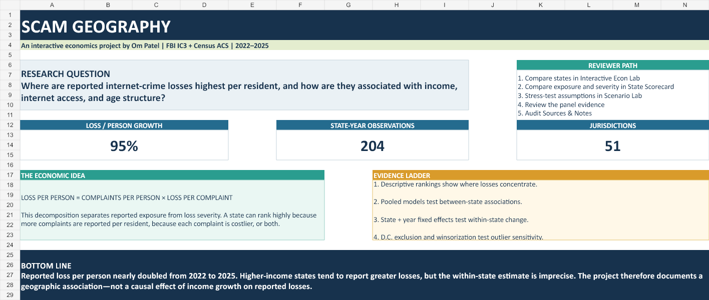
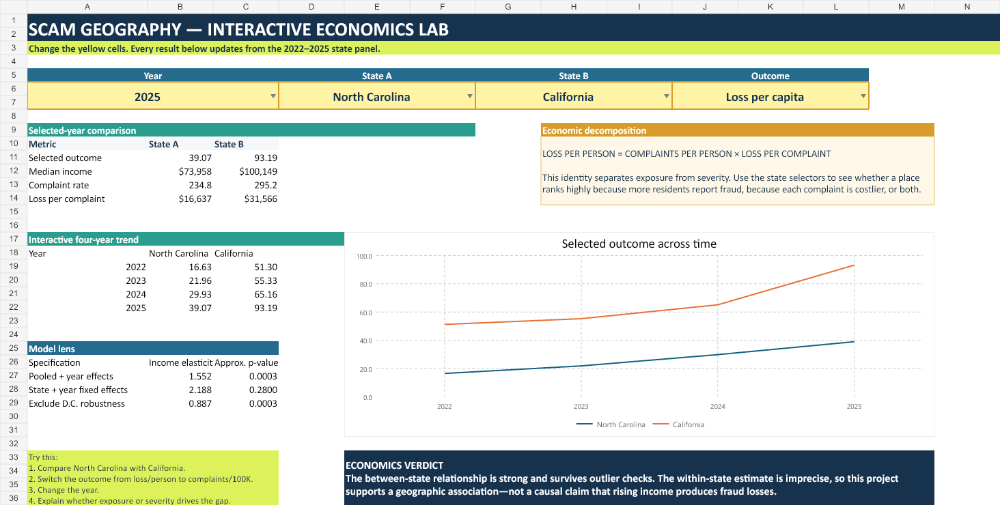
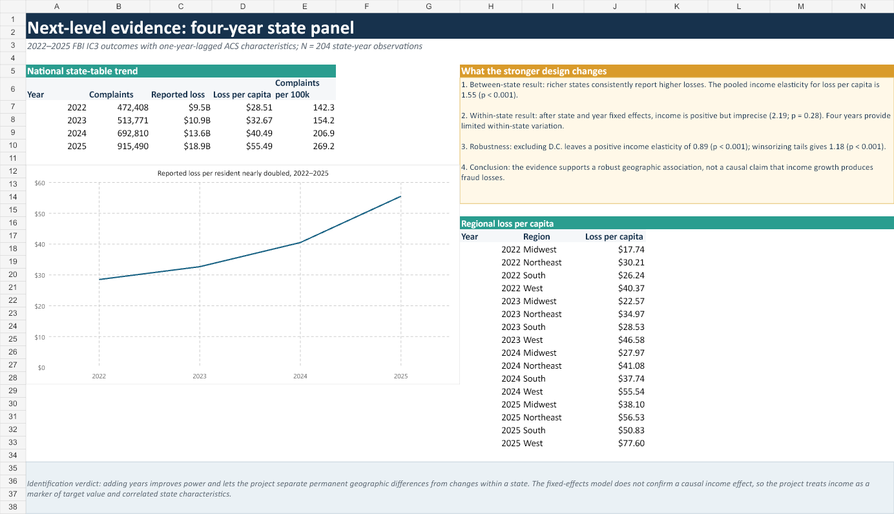
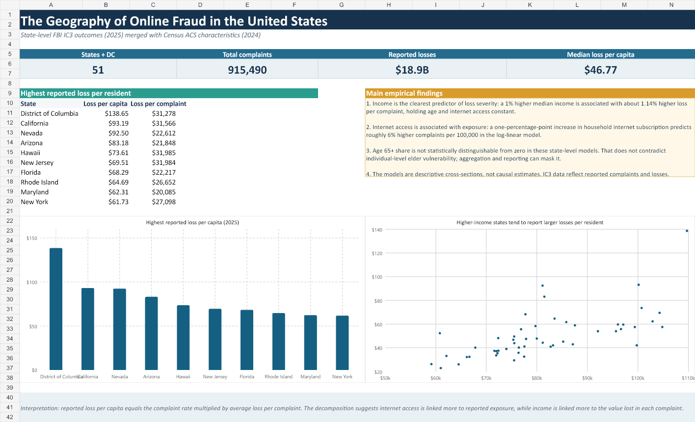

# Scam Geography

### An interactive economics project by Om

**How are online-fraud losses distributed across the United States, and do income, internet access, and demographic differences help explain the geography?**

This project combines FBI Internet Crime Complaint Center data with U.S. Census Bureau American Community Survey estimates to study reported online-fraud outcomes across 50 states and the District of Columbia from 2022 through 2025.

The centerpiece is an interactive Excel economics lab. Users can select a year, compare two states, change the outcome being measured, and watch the tables and trend graph update automatically.

## Download and explore

Download **[Scam_Geography_Interactive_Economics_Project.xlsx](Scam_Geography_Interactive_Economics_Project.xlsx)** and open it in desktop Microsoft Excel. Begin on the `Start Here` worksheet, then continue to `Interactive Econ Lab`.

On the `Interactive Econ Lab` worksheet, use the yellow dropdown cells to:

- choose a year from 2022–2025;
- compare any two states;
- switch between reported loss per person, complaints per 100,000 residents, and loss per complaint;
- see the percentage gap between the selected states for each economic measure;
- identify whether geographic differences reflect exposure, loss severity, or both; and
- compare pooled, fixed-effects, and outlier-robust regression evidence.

## Economics behind the project

The analysis uses the accounting identity:

> **Reported loss per person = complaints per person × reported loss per complaint**

This separates two economic mechanisms:

- **Exposure:** how frequently residents report being affected.
- **Severity:** how much money is lost in an average reported complaint.

The empirical models test whether median household income, the share of residents age 65 or older, and household internet access are associated with these outcomes. Year effects capture nationwide changes, while state-and-year fixed effects distinguish persistent geographic differences from changes within a state over time.

## Main findings

1. Reported loss per resident increased substantially between 2022 and 2025.
2. Higher-income states tend to report greater losses per resident in comparisons across states.
3. The pooled income elasticity of loss per capita is approximately **1.55** and is statistically significant.
4. Excluding Washington, D.C. leaves a positive elasticity of approximately **0.89**, suggesting the association is not driven by one extreme jurisdiction.
5. The state-and-year fixed-effects estimate is positive but statistically imprecise. The project therefore interprets income as a marker of target value and correlated geographic characteristics—not as proof that income growth causes fraud.

## Data and methods

- **Unit of observation:** state-year
- **Coverage:** 50 states and the District of Columbia, 2022–2025
- **Observations:** 204
- **Fraud outcomes:** complaints and reported losses from FBI IC3 annual reports
- **Economic and demographic variables:** population, median household income, age structure, and internet subscription from ACS one-year estimates
- **Timing:** ACS characteristics are lagged one year
- **Models:** pooled OLS with year effects; state-and-year fixed effects; D.C.-exclusion and winsorization robustness checks
- **Inference:** HC1 heteroskedasticity-robust standard errors with normal-approximation p-values

The analysis-ready panel is available in [`data/state_panel_2022_2025.csv`](data/state_panel_2022_2025.csv).
Variable definitions are documented in [`DATA_DICTIONARY.md`](DATA_DICTIONARY.md).

## Limitations

IC3 complaints are voluntary reports rather than a complete measure of fraud incidence. Reporting behavior may differ across states, extreme incidents can affect state averages, and ecological results cannot establish individual-level risk. The regression estimates are descriptive associations, not causal effects.

## Sources

- [FBI Internet Crime Complaint Center annual reports](https://www.ic3.gov/AnnualReport/Reports)
- [U.S. Census Bureau American Community Survey](https://www.census.gov/programs-surveys/acs)

## Portfolio summary

> Built an interactive Excel economics dashboard using a 204-observation state panel of FBI IC3 and Census ACS data. Applied economic decomposition, pooled regression, two-way fixed effects, and robustness tests to examine geographic differences in reported online-fraud exposure and loss severity.

## Tools demonstrated

`Excel` · `Data visualization` · `Econometrics` · `Panel data` · `Fixed effects` · `Robustness testing` · `Economic interpretation`
